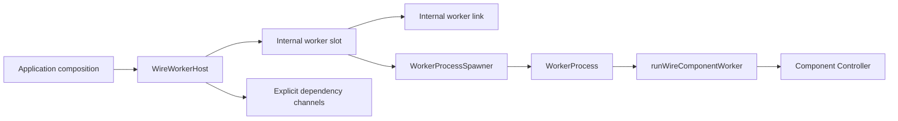

# Workers

A worker is a named, process-hosted `WireComponent` owned by a `WireWorkerHost`.
The host creates logical workers and returns a stable typed client from readiness. Internally, each worker has one
slot that owns readiness, supervision, reconnects, graceful shutdown, and process generations.
Low-level spawners create exactly one process generation.

See [Components](./components.md) for the authored component shape, local creation examples,
dependency requirements, and testing guidance. This page focuses on process supervision.

## Layers



- `WireWorkerHost` is a process ownership boundary. Composition roots inject a
  `WorkerProcessSpawner`, logger, clock, and defaults.
- The internal worker slot is the only multi-generation state machine. It keeps one stable
  connection/client while child processes restart underneath it; it is not an author-facing API.
- `WorkerProcessSpawner` is platform-specific and creates one generation. Use
  `childProcessSpawner()` from `@orkestra/wire/worker/node` for Node child
  processes.
- `runWireComponentWorker(component)` is the child-side IPC bridge. It bootstraps typed config,
  connects explicit dependency clients, creates the component, serves its controller, and signals
  readiness.

## Parent Side

```ts
import { createWireWorkerHost } from '@orkestra/wire/worker';
import { childProcessSpawner } from '@orkestra/wire/worker/node';
import { createScope } from '@orkestra/shared/concurrency';
import { counterComponent } from './component';
import { workerPath } from './worker-manifest';

const scope = createScope({ label: 'main' });
const host = createWireWorkerHost({
  scope,
  processSpawner: childProcessSpawner(),
});

const worker = host.create(counterComponent, {
  name: 'counter',
  executable: workerPath('counter'),
  dependencies: {},
  config: {},
});

const client = await worker.ready();
await client.increment(undefined);
await host.dispose();
```

`worker.ready()` starts the process, waits for the child ready signal, and returns the stable
typed client. The pending worker intentionally exposes no public client. Calls through a previously
returned client fail fast while the worker is unavailable; Wire does not buffer requests during
downtime.

Startup and exposure are explicit composition-site decisions. For eager startup, await
`worker.ready()` under an owning scope or call `host.spawn(component, options)` to get the client. For Electron
windows, compose a forwarding controller and use `exposeWireToWindows()` with a `beforeOpen` hook
that awaits `worker.ready()`.

## Child Side

```ts
import { runWireComponentWorker } from '@orkestra/wire/worker';
import { counterComponent } from './component';

void runWireComponentWorker(counterComponent);
```

The child helper resolves the parent IPC channel, requests bootstrap config and dependency channels,
serves framed runtime wire messages, sends the ready signal after the component controller is
installed, disposes the child scope on shutdown/disconnect, and exits with code `1` if creation
fails. It also exits with code `1` when the component reports an unrecoverable failure through
`fatal(error)`. The worker slot treats that exit like any other failed generation: it disconnects the
old transport and applies the configured supervision schedule before starting a fresh process.

## Pooled Workers

A process per worker buys fault isolation, and every process pays for its own Node runtime
(roughly 50 MB of physical footprint in the desktop app) before the component does any work.
`pooledProcessSpawner()` decorates a spawner so several workers share one host process:

```ts
import { createWireWorkerHost, pooledProcessSpawner, WORKER_NAME_ENV_VAR } from '@orkestra/wire/worker';
import { childProcessSpawner } from '@orkestra/wire/worker/node';

const host = createWireWorkerHost({
  scope,
  processSpawner: pooledProcessSpawner({
    scope,
    inner: childProcessSpawner(),
    hostEntry: workerPath('worker-pool-host'),
    // undefined keeps the worker in a dedicated process.
    poolFor: (spec) => poolByWorkerName[spec.env?.[WORKER_NAME_ENV_VAR] ?? ''],
  }),
});
```

The host entry only calls `runWorkerPoolHost()` from `@orkestra/wire/worker/node`. It evaluates the
unchanged worker entry files on request; `runWireComponentWorker` and `initWorkerProcessLogging`
detect that they run inside a pool and use a virtual parent port and a virtual exit.

Each pooled worker still gets its own `WorkerProcess`, so slots, supervision, bootstrap, dependency
channels, and vitals work unchanged. What changes is the failure model:

- A member that shuts down, fails to start, or calls `fatal(error)` ends only itself. Its slot
  restarts it inside the same host, which re-evaluates the entry file.
- A crash of the host process (uncaught exception, native crash, out of memory) ends every member,
  and each slot restarts its worker in a fresh host. After `maxPoolCrashes` such crashes (default
  2) the pool is abandoned and its workers fall back to dedicated processes for the rest of the
  session, so one crash-looping member cannot exhaust its poolmates' retry budgets.
- A member that ignores the shutdown signal past its grace period can only be killed with its
  host. The kill waits for poolmates that are still inside their own grace period, so stopping the
  whole host is not cut short by the shortest deadline.
- Members share one event loop. A member that blocks it stalls its poolmates.

Pool workers that are cheap to restart together. Keep workers that own live user sessions (PTYs,
agent processes) or that run long synchronous bursts in dedicated processes. The desktop layout
lives in `apps/orkestra-desktop/src/main/gateway/worker-pools.ts`; `ORKESTRA_WORKER_POOLS=off`
disables pooling there.
